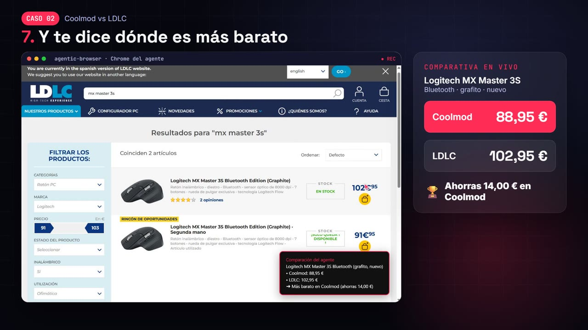
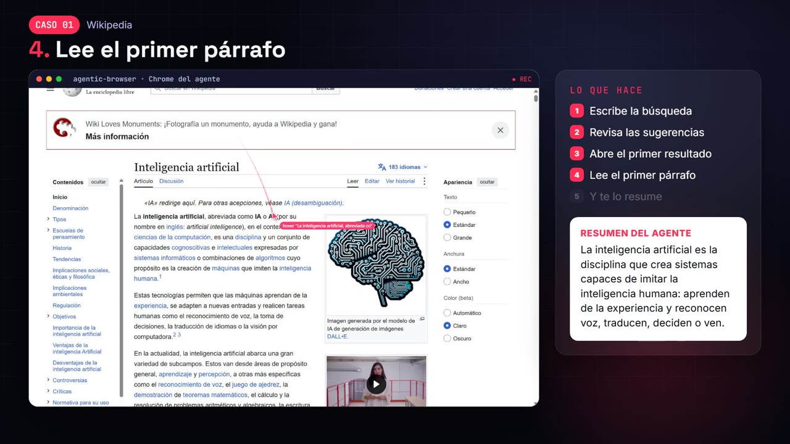
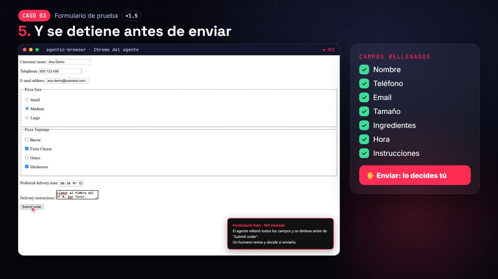

<p align="center"></p>

# agentic-browser

**Dale a cualquier agente de IA un navegador real y mira todo lo que hace.**

Creado y mantenido por **[Davarion](https://www.davarion.com)**.

> **Sin API key y sin cobros extra.** agentic-browser es una herramienta, no un modelo: corre en tu ordenador y usa el "cerebro" que tu agente ya tiene. Puede ser tu plan Claude Pro/Max en Claude Code, tu plan de ChatGPT en Codex, Cursor o un modelo local. No hay que registrarse ni pagar por token.

Las personas usamos navegadores para movernos por la web; los agentes normalmente necesitan APIs. agentic-browser permite que cualquier agente use **tu Google Chrome instalado** como lo haría una persona. Percibe las páginas como texto compacto con coordenadas en píxeles, en lugar de capturas, y un cursor visible muestra cada movimiento y cada clic.

[English](README.md) · [Casos de uso](docs/USE_CASES.md) · [Vigilante de chats](docs/WATCHER.md) · [Arquitectura](docs/ARCHITECTURE.md) · [Seguridad](SECURITY.md) · [Aviso de responsabilidad](DISCLAIMER.md)

<p align="center">
  <a href="docs/media/agentic-browser-15s-es.mp4"></a>
</p>
<p align="center">
  ▶ <a href="docs/media/agentic-browser-15s-es.mp4"><b>Ver la demo de 15 segundos</b></a> · ▶ <a href="docs/media/agentic-browser-promo-es.mp4"><b>Ver el video completo (1 min)</b></a>
</p>

<p align="center"></p>
<p align="center">
  
  
</p>
<p align="center"><em>Ejecuciones reales grabadas por el propio agente: comparar precios · investigar en la web · rellenar un formulario y detenerse antes de enviar.</em></p>

## Por qué

| Problema de los agentes de navegador actuales | agentic-browser |
|---|---|
| Cada captura cuesta ~1.000–1.500 tokens | Snapshot de texto: ~15 tokens por elemento. `diff: true` devuelve solo lo que cambió |
| El agente adivina coordenadas a partir de una imagen | Cada elemento trae su centro exacto `@x,y`. `browser_element_at(x, y)` dice qué hay en cualquier píxel, sin imagen |
| No ves qué está haciendo el agente | Un cursor rojo viaja hasta cada objetivo, deja una onda al hacer clic y muestra una etiqueta con la acción |
| Atado a un solo framework de agentes | Servidor MCP **y** API HTTP/JSON: Claude, GPT, Gemini, Hermes, OpenClaw, LangChain, n8n, curl… |
| Versiones recortadas de Chromium | Tu Chrome real: extensiones, códecs, PDF, WebGPU y actualizaciones automáticas |
| Otra API key y otra factura | **Ninguna.** Funciona con la suscripción que tu agente ya usa; incluso el vigilante opcional puede correr con tu plan de Claude |

Medición real: una búsqueda en Wikipedia de 7 pasos gastó **≈ 2.540 tokens** en respuestas de herramientas. Con capturas habría costado unos 9.000–10.000.

## Inicio rápido

**En una línea (Claude Code):**

```bash
claude mcp add agentic-browser -- npx -y agentic-browser-mcp
```

En cualquier otro cliente MCP: `"command": "npx", "args": ["-y", "agentic-browser-mcp"]`. Requisitos: Node ≥ 18 y Chrome (o Edge).

### Desde el código fuente

Requisitos: Node ≥ 18 y Google Chrome.

```bash
git clone https://github.com/davarion-tech/agentic-browser.git
```

```bash
cd agentic-browser && npm install
```

```bash
npm run doctor
```

```bash
npm test
```

### Desde un cliente MCP

Claude Code:

```bash
claude mcp add agentic-browser -- node /ruta/absoluta/agentic-browser/src/mcp.js
```

Claude Desktop, Cursor, Codex, Hermes, OpenClaw o cualquier cliente MCP: usa [examples/mcp-config.json](examples/mcp-config.json).

**Comando para Claude Code (opcional):** copia `skills/agentic-browser` en `~/.claude/skills/`. Así `/agentic-browser <tarea>` siempre usa este navegador y no otra herramienta de navegación integrada.

Prueba de ejemplo para tu agente:

> Usa SOLO las herramientas browser_* de agentic-browser. Abre es.wikipedia.org, busca "Chrome DevTools Protocol", entra al primer resultado y resume el primer párrafo. No uses capturas de pantalla.

Si tu cliente trae otros navegadores (el integrado de la app, Claude in Chrome), indícale explícitamente que use agentic-browser.

### Desde cualquier otro lenguaje (HTTP)

```bash
npm run http
```

```bash
curl -s -X POST http://127.0.0.1:8787/tools/browser_navigate -d "{\"url\":\"example.com\",\"snapshot\":true}"
```

`GET /tools` devuelve el JSON Schema de cada herramienta, listo para usarlo como definición de funciones en cualquier API de LLM. Hay un cliente Python sin dependencias en [examples/python_client.py](examples/python_client.py).

## Opcional: vigilante de chats

> **Viene apagado.** Instalar agentic-browser solo permite que tu agente use el navegador cuando se lo pidas. El vigilante es un proceso aparte que activas **tú**.

El vigilante mantiene abiertas las pestañas de mensajería del agente (WhatsApp Web, Telegram, Messenger…). Esperar no cuesta tokens; cuando llega un mensaje, despierta a Claude para leerlo y proponer respuesta. Una política aplicada en código decide qué pasa después:

- **observe:** solo te avisa.
- **draft** (por defecto): escribe la respuesta pero nunca la envía.
- **auto:** envía, pero solo a una lista blanca. Las palabras sensibles, el límite por hora y el bloqueo de dominio se aplican en todos los modos.

```bash
npm run setup
```

```bash
npm run watcher
```

Funciona con tu suscripción de Claude (`claude setup-token`) o con una API key. Lee antes [docs/WATCHER.md](docs/WATCHER.md) y el [Aviso de responsabilidad](DISCLAIMER.md): muchas plataformas prohíben los bots no oficiales.

## Herramientas

| Herramienta | Uso |
|---|---|
| `browser_snapshot` | **Percepción principal.** Elementos visibles con ref, rol, nombre, estado y centro `@x,y`. Con `diff: true`, solo los cambios |
| `browser_find` | Busca elementos por texto en toda la página, incluso fuera de pantalla |
| `browser_element_at` | Píxel → elemento (rol, texto, si es clicable, ruta DOM), sin imagen |
| `browser_cursor` | Dónde está el cursor del agente y qué hay debajo |
| `browser_click` / `browser_move` | Clic o hover visible por `ref` o `x,y` |
| `browser_type` / `browser_press` | Teclado real: `clear`, `submit`, atajos como `Control+L` |
| `browser_scroll` / `browser_drag` | Rueda del ratón; arrastrar y soltar |
| `browser_select` / `browser_upload` | Opciones de `<select>`; subida de archivos |
| `browser_navigate` / `browser_history` / `browser_tabs` | Navegación y pestañas |
| `browser_read` / `browser_eval` | Texto legible (marcado como contenido no confiable); JS arbitrario (solo con `AGENT_ALLOW_EVAL=1`) |
| `browser_wait` / `browser_watch` | Esperar tiempo, un texto o un selector. `browser_watch` espera con **cero tokens** hasta que la página cambia (mensaje nuevo, título "(3) Bandeja"…) |
| `browser_request_human` | Pasa el control a la persona que mira (login, 2FA, CAPTCHA, una decisión) con un banner en la página |
| `browser_console` / `browser_events` / `browser_trace` | Consola y errores JS; diálogos, descargas y pestañas nuevas; registro de auditoría de cada acción |
| `browser_cursor_style` | Mostrar u ocultar el cursor o su estela |
| `browser_record_start` / `browser_record_stop` | Graba en vídeo la pestaña activa, con el cursor rojo, para clips de demo sin OBS. MP4 (H.264) si `ffmpeg` está en el PATH; si no, WebM. Devuelve ruta, duración y tamaño |
| `browser_screenshot` | Último recurso: JPEG de la página o de un solo `ref` |

**Fiabilidad:** si la página se re-renderiza, el ref se recupera cuando el elemento se puede identificar sin ambigüedad. Los clics avisan si un modal tapa el objetivo (`occluded`). Se recorren shadow DOM abierto e iframes. Las pestañas nuevas, los diálogos y las descargas se informan en la respuesta de la acción. Repetir la misma llamada tres veces dispara un aviso de bucle.

## Configuración

| Variable | Por defecto | |
|---|---|---|
| `AGENT_HEADLESS` | `0` | `1` = sin ventana (servidores, CI) |
| `AGENT_CDP_URL` | — | Adjuntarse a un Chrome ya abierto con `--remote-debugging-port=9222 --user-data-dir=…` |
| `AGENT_PROFILE` | `~/.agentic-browser/profile` | Perfil persistente del agente (cookies y sesiones sobreviven entre reinicios) |
| `AGENT_DOWNLOADS` | `~/.agentic-browser/downloads` | Carpeta de descargas |
| `AGENT_CURSOR_SPEED` | `120` | ms por cada 100 px de recorrido; `0` = instantáneo |
| `AGENT_TOOLS` | `all` | `core` (12 esenciales) o una lista separada por comas. Menos herramientas, menos tokens en el prompt |
| `AGENT_READONLY` | `0` | `1` desactiva toda herramienta que modifique la página |
| `AGENT_ALLOWED_ORIGINS` | — | Lista blanca de dominios, p. ej. `wikipedia.org,localhost` (incluye subdominios) |
| `AGENT_DIALOGS` | `dismiss` | `alert/confirm/prompt`: `dismiss` (por defecto desde 1.1.0: un `confirm("¿Borrar?")` nunca se acepta solo) o `accept`. El texto del diálogo llega al agente en los eventos |
| `AGENT_TRACE` | `~/.agentic-browser/trace.jsonl` | Registro de auditoría de cada llamada |
| `AGENT_CHROME` | autodetectado | Ruta al navegador. Sirve cualquier Chromium: Chrome, Edge (se usa solo si no hay Chrome), Brave, Chromium |
| `AGENT_HTTP_PORT` / `AGENT_TOKEN` | `8787` / generado | Puerto HTTP y token Bearer **obligatorio**. Sin `AGENT_TOKEN` se genera uno en `~/.agentic-browser/http-token` (ruta cambiable con `AGENT_TOKEN_FILE`). Se rechazan las peticiones que vienen de páginas web |
| `AGENT_ALLOW_EVAL` | `0` | `1` activa `browser_eval` (desactivada por defecto: puede leer cookies y sacar datos) |
| `AGENT_UPLOAD_DIRS` | carpeta de descargas | Carpetas desde las que `browser_upload` puede subir archivos, separadas por `;` en Windows y `:` en macOS/Linux |
| `AGENT_RECORDINGS` | `~/.agentic-browser/recordings` | Carpeta donde `browser_record_stop` guarda los vídeos |
| `AGENT_FFMPEG` | `ffmpeg` | Ruta a ffmpeg para grabar en MP4; `none` fuerza el WebM sin dependencias |

## Límites

- **Canvas, WebGL y mapas:** el DOM no describe lo que se dibuja dentro. Usa `browser_screenshot` con un `ref` para pagar solo esa zona.
- **Shadow roots cerrados:** no exponen sus hijos.
- **UI propia de Chrome** (barra de direcciones, menús, avisos de permisos): no es DOM. Usa `browser_navigate`, `browser_tabs` y las variables de entorno.
- **No resuelve CAPTCHAs ni evade detección de bots.** El agente debe usar `browser_request_human`.
- Las versiones recientes de Chrome bloquean el control remoto sobre tu perfil personal **por defecto**. El agente usa su propio perfil; inicia sesión ahí una vez.

## Hoja de ruta

Basada en las quejas más frecuentes sobre los agentes de navegador (refs obsoletos, exceso de tokens, popups, conflictos entre agentes, inyección de instrucciones, observabilidad):

- [x] **Vigilante de chats** para cuentas propias del agente: despierta con cero tokens ante mensajes nuevos y responde bajo una política aplicada en código (borrador por defecto, lista blanca, palabras sensibles, límite por hora, bloqueo de dominio). Ver [docs/WATCHER.md](docs/WATCHER.md).
- [ ] Sesiones multi-agente sobre un mismo perfil, con pestañas con dueño.
- [ ] `browser_batch`: varias acciones en una sola llamada.
- [ ] Detección de texto oculto con CSS como señal de inyección de instrucciones.
- [ ] Repetición de sesiones: traza más GIF o vídeo del cursor.

## Legal

Publicado bajo la [Licencia MIT](LICENSE). Se ofrece **tal cual, sin garantía**. **El uso que tú y tus agentes hagan de este software es responsabilidad exclusivamente tuya**, incluido el cumplimiento de la ley y de los términos de servicio de los sitios que automatices. Lee el [Aviso de responsabilidad](DISCLAIMER.md) completo.

Hecho por [Davarion](https://www.davarion.com). No está afiliado a Google. "Google Chrome" es una marca de Google LLC.
