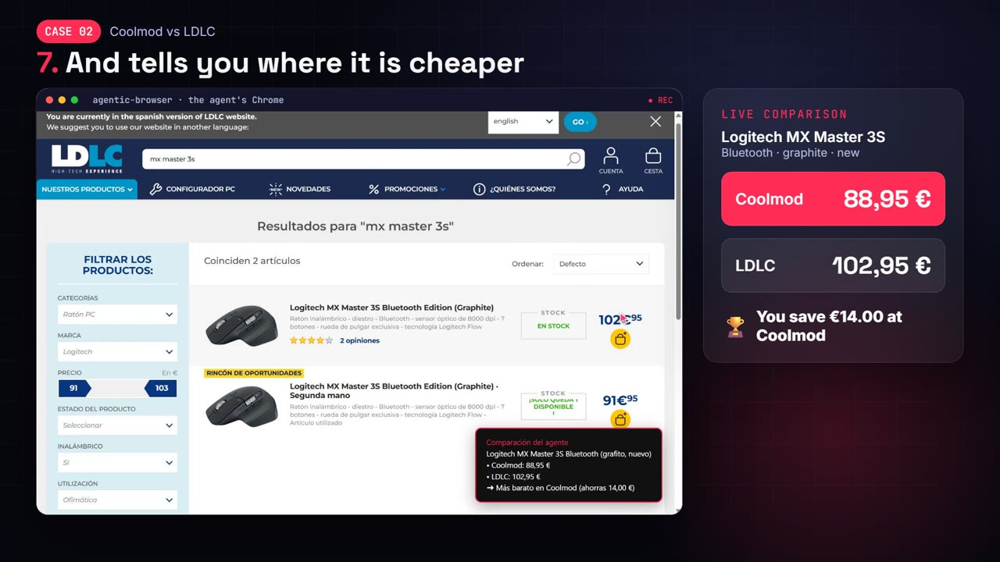
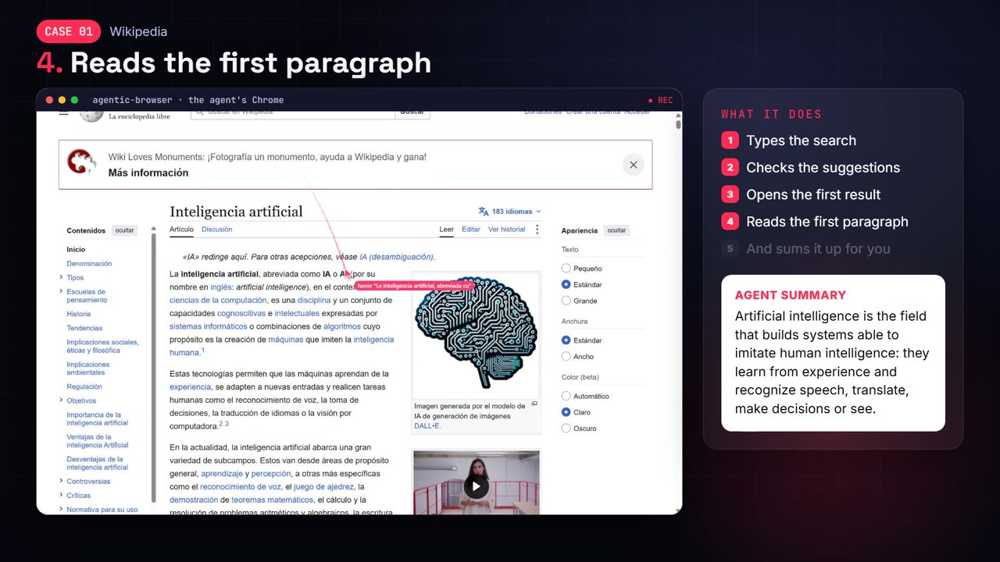
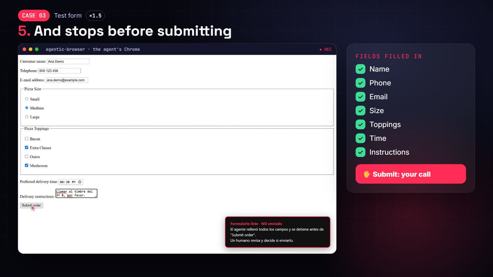

<p align="center"></p>

# agentic-browser

**Give any AI agent a real browser and watch everything it does.**

Built and maintained by **[Davarion](https://www.davarion.com)**.

> **No API key. No extra bill.** agentic-browser is a tool, not a model: it runs on your computer and uses whatever brain your agent already has. That can be your Claude Pro/Max plan in Claude Code, your ChatGPT plan in Codex, Cursor, or a local model. Nothing to sign up for and no per-token charges from us.

Humans browse the web with browsers. Agents usually need APIs. agentic-browser lets any agent use **your installed Google Chrome** the way a person does. It perceives pages as compact text with pixel coordinates instead of screenshots, and a visible cursor shows every move and click.

[Español](README.es.md) · [Use cases](docs/USE_CASES.md) · [Chat watcher](docs/WATCHER.md) · [Architecture](docs/ARCHITECTURE.md) · [Security](SECURITY.md) · [Disclaimer](DISCLAIMER.md)

<p align="center">
  <a href="docs/media/agentic-browser-15s.mp4"></a>
</p>
<p align="center">
  ▶ <a href="docs/media/agentic-browser-15s.mp4"><b>Watch the 15-second demo</b></a> · ▶ <a href="docs/media/agentic-browser-promo.mp4"><b>Watch the full video (1 min)</b></a>
</p>

<p align="center"></p>
<p align="center">
  
  
</p>
<p align="center"><em>Real runs recorded by the agent itself: compare prices · research the web · fill a form and stop before submitting.</em></p>

## Why

| Problem with today's browser agents | agentic-browser |
|---|---|
| Screenshots cost ~1,000–1,500 tokens per look | Text snapshot: ~15 tokens per element. `diff: true` returns only what changed |
| Agents guess coordinates from images | Every element comes with its exact center `@x,y`. `browser_element_at(x, y)` tells what is at any pixel, with no image |
| You can't see what the agent is doing | A red cursor travels to each target, ripples on click and labels the action |
| Locked into one agent framework | MCP server **and** a plain HTTP/JSON API: Claude, GPT, Gemini, Hermes, OpenClaw, LangChain, n8n, curl… |
| Stripped-down Chromium builds | Your real Chrome: extensions, codecs, PDF, WebGPU, auto-updates |
| Yet another API key and bill | **None.** Works with the subscription your agent already uses; even the optional chat watcher can run on your Claude plan |

## Quick start

**One line (Claude Code):**

```bash
claude mcp add agentic-browser -- npx -y agentic-browser-mcp
```

Any other MCP client: use `"command": "npx", "args": ["-y", "agentic-browser-mcp"]`. Requirements: Node ≥ 18 and Chrome (or Edge).

### From source

Requirements: Node ≥ 18 and Google Chrome.

```bash
git clone https://github.com/davarion-tech/agentic-browser.git
```

```bash
cd agentic-browser && npm install
```

```bash
npm run doctor
```

```bash
npm test
```

### Use it from an MCP client

Claude Code:

```bash
claude mcp add agentic-browser -- node /absolute/path/to/agentic-browser/src/mcp.js
```

Claude Desktop, Cursor, Codex, Hermes, OpenClaw or any MCP client: see [examples/mcp-config.json](examples/mcp-config.json).

**Claude Code slash command (optional):** copy `skills/agentic-browser` into `~/.claude/skills/`. Then `/agentic-browser <task>` always uses this browser instead of any other built-in browser tool.

Then ask your agent something like:

> Use only the browser_* tools from agentic-browser. Open es.wikipedia.org, search for "Chrome DevTools Protocol", open the first result and summarize the first paragraph. Don't take screenshots.

### Use it from anything else (HTTP)

```bash
npm run http
```

```bash
curl -s -X POST http://127.0.0.1:8787/tools/browser_navigate -d "{\"url\":\"example.com\",\"snapshot\":true}"
```

`GET /tools` returns the JSON Schema of every tool, ready to pass as function definitions to any LLM API. A dependency-free Python client is in [examples/python_client.py](examples/python_client.py).

## Optional: chat watcher

> **Off by default.** Installing agentic-browser only lets your agent use the browser when you ask it to. The watcher is a separate process that **you** turn on.

The watcher keeps the agent's own messaging tabs open (WhatsApp Web, Telegram, Messenger…). Waiting costs zero tokens; when a message arrives, it wakes Claude to read it and propose a reply. A code-enforced policy controls what happens next:

- **observe:** only notifies you.
- **draft** (default): writes the reply but never sends it.
- **auto:** sends, but only to an allowlist. Sensitive keywords, an hourly limit and a domain lock apply in every mode.

```bash
npm run setup
```

```bash
npm run watcher
```

It runs on your Claude subscription (`claude setup-token`) or an API key. Read [docs/WATCHER.md](docs/WATCHER.md) and the [Disclaimer](DISCLAIMER.md) first: many platforms forbid unofficial bots.

## What the agent sees

```
# Test bench
url: http://localhost:3000/
viewport 1280x800 scroll=0,0 docH=2090
[3] textbox "Search" ph="type something" @191,124
[4] button "Search" @339,124
[5] select "color" value="Red" opts=[*Red|Green|Blue] @429,124
[6] checkbox "I agree" {checked} @492,124
[10] button "Button in shadow DOM" @652,316
[f1:1] button "Button inside iframe" @214,217
```

## New in 1.2

- **Teach it once, replay forever.** `browser_teach_start` records a task while *you* do it in the agent's Chrome (clicks, text, selects, Enter). It is saved as a recipe of roles and names, not pixels, so it survives layout changes. `browser_replay` repeats it with new values (`{"search": "October invoices"}`) without perceiving every step. Passwords are never recorded: on replay, the person types them.
- **An "Enseñar" (teach) button in the browser.** A small tab on the left edge of the agent's Chrome starts a recording without asking the agent. Name the recipe in the banner, press Finish, then tell your agent "repeat <name>". Disable it with `AGENT_TEACH_BUTTON=0`.
- **A clean screen.** Chrome's translate bar, search-engine choice, restore-pages bubble and permission prompts are off (permissions are denied). After every navigation, website popups (language, newsletter, cookie banners, "Sign in with Google") are closed with visible clicks on their close or reject button, never accept, subscribe or sign in. `browser_dismiss` does it on demand; `AGENT_AUTO_DISMISS=0` turns the automatic pass off.
- **Structured data in one call.** `browser_extract` turns the most relevant table or repeated list (products, search results, contacts) into JSON or CSV rows with title, link, price and image. Merged table headers are resolved. CSV output is safe to open in Excel.
- **Live token counter.** `browser_cursor_style({ hud: true })` (or `AGENT_HUD=1`) shows, in the corner of the page, the tokens used against what screenshots would have cost. `browser_stats` returns the same numbers. Formula: tokens ≈ characters / 4; one screenshot ≈ width × height / 750 per perception call.

## Tools

| Tool | Purpose |
|---|---|
| `browser_snapshot` | **Main perception.** Visible elements with ref, role, name, state and center `@x,y`. `diff: true` returns only changes |
| `browser_find` | Find elements by text anywhere on the page, including off-screen |
| `browser_element_at` | Pixel → element (role, text, clickable, DOM path), with no image |
| `browser_cursor` | Where the agent's cursor is and what is under it |
| `browser_click` / `browser_move` | Visible click or hover by `ref` or `x,y` (buttons, double click, modifiers) |
| `browser_type` / `browser_press` | Real keyboard input: `clear`, `submit`, shortcuts like `Control+L` |
| `browser_scroll` / `browser_drag` | Mouse wheel; drag and drop |
| `browser_select` / `browser_upload` | `<select>` options; file inputs |
| `browser_navigate` / `browser_history` / `browser_tabs` | Navigation and tabs |
| `browser_read` / `browser_eval` | Readable text (wrapped as untrusted content); arbitrary JS (only with `AGENT_ALLOW_EVAL=1`) |
| `browser_extract` | Table or repeated list → JSON or CSV rows (title, url, price, image…). `file` saves it to disk |
| `browser_teach_start` / `browser_teach_stop` | Record a task the person performs once, as a reusable recipe |
| `browser_recipes` / `browser_replay` | List or show recipes; replay one with new `params` at almost zero tokens |
| `browser_stats` | Tokens used this session vs. the screenshot equivalent |
| `browser_dismiss` | Close popups covering the page (close or reject only, never accept). Runs automatically after `browser_navigate` |
| `browser_batch` | Several actions in one call, in order, stopping at the first error. Saves one agent turn per action |
| `browser_wait` / `browser_watch` | Wait for time, text or selector. `browser_watch` sleeps at **zero tokens** until the page changes (new message, title "(3) Inbox"…) |
| `browser_request_human` | Hand control to the person watching (login, 2FA, CAPTCHA, a decision) through an on-page banner |
| `browser_console` / `browser_events` / `browser_trace` | JS console and errors; dialogs, downloads and new tabs; audit trail of every action |
| `browser_cursor_style` | Show or hide the cursor, its trail or the live token counter (`hud`) |
| `browser_record_start` / `browser_record_stop` | Record the active tab as a video, red cursor included, for demo clips without OBS. MP4 (H.264) when `ffmpeg` is on the PATH, otherwise WebM. Returns path, duration and size |
| `browser_screenshot` | Last resort: JPEG of the page or of a single `ref` |

Most actions accept `snapshot: true` and return the new page state in the same response, which saves one agent turn per step.

**Reliability features:** refs survive re-renders when the element can be uniquely re-identified. Clicks warn when a modal covers the target (`occluded`). Open shadow DOM and iframes are traversed. New tabs, dialogs and downloads are reported in the action result. Repeating the same call three times triggers a loop warning.

## Configuration

| Variable | Default | |
|---|---|---|
| `AGENT_HEADLESS` | `0` | `1` = no window (servers, CI) |
| `AGENT_CDP_URL` | — | Attach to a running Chrome started with `--remote-debugging-port=9222 --user-data-dir=…` |
| `AGENT_PROFILE` | `~/.agentic-browser/profile` | Persistent agent profile (cookies and logins survive restarts) |
| `AGENT_DOWNLOADS` | `~/.agentic-browser/downloads` | Download folder |
| `AGENT_SPEED` | `normal` | `fast` for daily work (cursor moves ≤ 250 ms, no delay between keystrokes), `demo` for recordings (slower, easy to follow) |
| `AGENT_CURSOR_SPEED` | from `AGENT_SPEED` | ms per 100 px of cursor travel; `0` = instant |
| `AGENT_VIEWPORT` | window size | With a window, Chrome opens maximized and the page uses the real window size. `1280x800` fixes it (headless always uses 1280×800) |
| `AGENT_TOOLS` | `all` | `core` (13 essential tools) or a comma-separated list. Fewer tools means fewer prompt tokens |
| `AGENT_AUTO_DISMISS` | `1` | `0` stops closing website popups after each navigation |
| `AGENT_TEACH_BUTTON` | `1` | `0` hides the floating "Enseñar" button |
| `AGENT_HUD` | `0` | `1` shows the live token counter from the start |
| `AGENT_RECIPES` | `~/.agentic-browser/recipes` | Where taught recipes are saved (JSON) |
| `AGENT_EXPORTS` | `~/.agentic-browser/exports` | Where `browser_extract` writes files |
| `AGENT_READONLY` | `0` | `1` disables every tool that changes a page |
| `AGENT_ALLOWED_ORIGINS` | — | Domain allowlist, e.g. `wikipedia.org,localhost` (subdomains included) |
| `AGENT_DIALOGS` | `dismiss` | `alert/confirm/prompt`: `dismiss` (default since 1.1.0: a `confirm("Delete?")` is never accepted on its own) or `accept`. The dialog text reaches the agent as an event |
| `AGENT_TRACE` | `~/.agentic-browser/trace.jsonl` | Audit log of every tool call |
| `AGENT_CHROME` | auto-detected | Path to the browser. Any Chromium browser works: Chrome, Edge (falls back to it automatically), Brave, Chromium |
| `AGENT_HTTP_PORT` / `AGENT_TOKEN` | `8787` / generated | HTTP port and **required** Bearer token. Without `AGENT_TOKEN`, one is generated in `~/.agentic-browser/http-token` (path configurable with `AGENT_TOKEN_FILE`). Requests coming from web pages are rejected |
| `AGENT_NO_SANDBOX` | `0` | `1` launches Chrome without its sandbox. Only for Linux as root or containers where the sandbox cannot start; it lowers isolation |
| `AGENT_ALLOW_EVAL` | `0` | `1` enables `browser_eval` (off by default: it can read cookies and exfiltrate data) |
| `AGENT_UPLOAD_DIRS` | downloads folder | Folders `browser_upload` may upload from, separated by `;` on Windows and `:` on macOS/Linux |
| `AGENT_RECORDINGS` | `~/.agentic-browser/recordings` | Where `browser_record_stop` saves videos |
| `AGENT_FFMPEG` | `ffmpeg` | Path to ffmpeg for MP4 recordings; `none` forces the WebM fallback |

## Limits

- **Canvas, WebGL and maps:** the DOM doesn't describe what is drawn inside them. Use `browser_screenshot` with a `ref` to pay only for that area.
- **Closed shadow roots** don't expose their children.
- **Chrome's own UI** (address bar, menus, permission prompts) is not part of the DOM. Use `browser_navigate`, `browser_tabs` and the environment variables instead.
- **No CAPTCHA solving and no bot-detection evasion.** The agent should call `browser_request_human`.
- Recent Chrome versions block remote debugging on your **default** personal profile. The agent uses its own profile; log in there once.

## Roadmap

Based on the most common complaints about browser agents (stale refs, token bloat, popups, multi-agent conflicts, prompt injection, observability):

- [x] Reference **chat watcher** for agent-owned accounts: wakes on new messages at zero tokens and replies under a code-enforced policy (draft by default, allowlist, sensitive keywords, rate limit, domain lock). See [docs/WATCHER.md](docs/WATCHER.md).
- [x] Teach mode and recipe replay, structured extraction, a live token counter, popup dismissal and `browser_batch` (1.2).
- [ ] Multi-agent sessions on one profile, with tab ownership and leases.
- [ ] `browser_batch`: several actions in one call.
- [ ] Hidden-text detection (instructions hidden with CSS) as a prompt-injection signal.
- [ ] Session replay: trace plus a GIF/video of the cursor.

## Legal

Released under the [MIT License](LICENSE). Provided **as is, without warranty**. **You are solely responsible for how you and your agents use this software.** That includes compliance with the law and with the terms of service of the sites you automate. Read the full [Disclaimer](DISCLAIMER.md).

Made by [Davarion](https://www.davarion.com). Not affiliated with Google. "Google Chrome" is a trademark of Google LLC.
